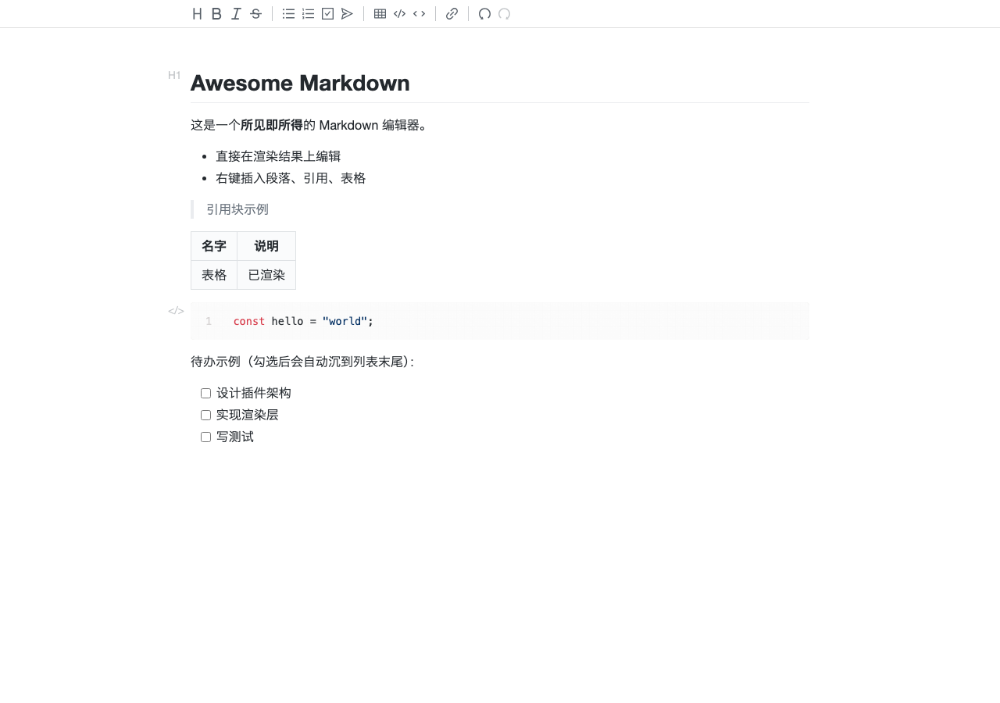
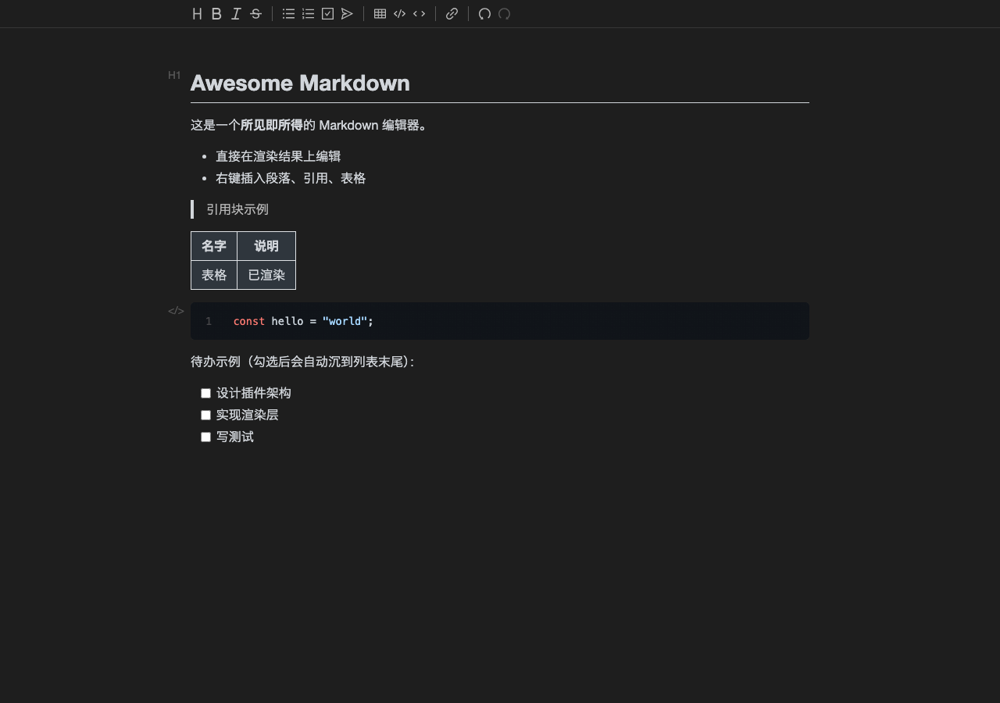
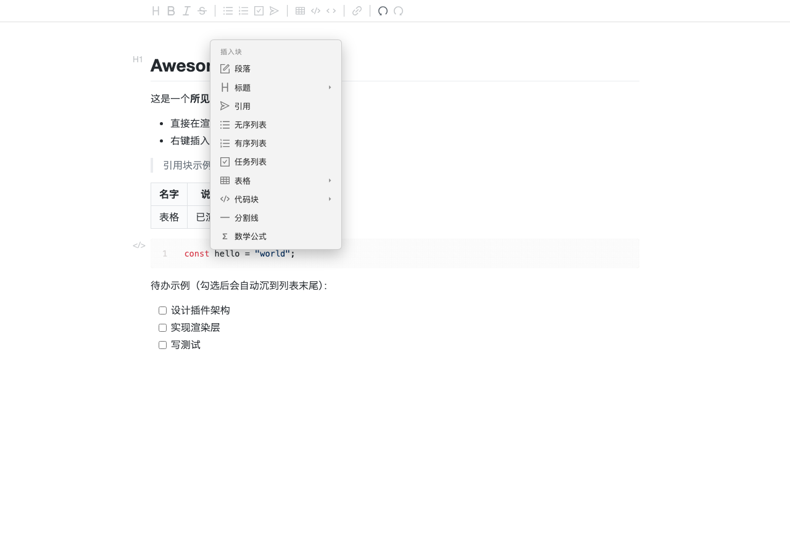

# Awesome Markdown

在 VS Code 里像 Typora 一样**直接在渲染后的 Markdown 上编辑**：标题、表格、代码块都以最终形态呈现，光标落在渲染结果上就能改字，不用在源码和预览之间来回切换。





## 为什么用它

VS Code 自带的 Markdown 预览是只读的，普通文本编辑器看不到表格、标题的真实排版。Awesome Markdown 把 `.md` 打开成一个可视化编辑器，边写边看到最终效果。

## 功能

### 直接在渲染结果上编辑

- 标题、加粗、斜体、删除线、列表、引用、表格、代码块全部按渲染结果呈现，语法标记隐藏。
- 图片、链接、数学公式（KaTeX）正常渲染。
- 表格是**真的表格**，能点进单元格改内容，不是一行 `| a | b |` 的源码。

### 右键插入块

在正文任意位置右键，弹出带图标的块菜单，一键插入：

| 块 | 选项 |
|---|---|
| 段落 | — |
| 标题 | H1 - H4 |
| 引用 | — |
| 列表 | 无序 / 有序 / 任务列表 |
| 表格 | 2×2、3×3、4×3、5×4，或自定义行数与列数 |
| 代码块 | JavaScript / TypeScript / Python / Go / Java / SQL / Bash / JSON / 纯文本 |
| 其它 | 分割线、数学公式 |



菜单图标与顶部工具栏同源，认得出来是哪个操作。

### 任务列表勾选后自动沉底

勾选一个待办项，它会自动落在这个列表的末尾，未完成项的顺序不变——和 macOS 备忘录一样。只重排当前列表，编辑器不重建，光标和滚动位置都不跳。

可在设置里用 `awesomeMarkdown.taskListSort` 关掉。

### 其它细节

- **自带大纲**：资源管理器里会出现「Awesome Markdown 大纲」，按标题层级列出当前文件的所有标题，点一条就在可视化编辑器里滚动定位过去（被折叠的上层标题会自动展开，落点高亮一下）。VS Code 原生的 Outline 在自定义编辑器下拿不到符号，所以插件自带了这个视图。
- **标题折叠**：鼠标移到标题左侧会出现小三角，点一下收起这个标题下的所有内容（子标题和正文一起收起，遇到同级或更高级标题才停），再点展开。折叠只影响显示，Markdown 源一个字都不改，折叠状态在继续编辑时保持。
- **工具栏中文提示**：鼠标悬停在顶部图标上会显示「标题 / 粗体 / 插入表格 / 代码块」等中文说明。
- **字数在状态栏**：右下角状态栏显示当前文档的字数（非空白字符），不占编辑区。
- **跟随主题**：浅色 / 深色主题自动切换，工具栏、菜单、代码块配色一致。
- **存档一致**：编辑内容通过 `WorkspaceEdit` 写回真实文档，脏标记、`Cmd/Ctrl+S`、diff、git 都正常工作。
- **随时切回文本编辑器**：标题栏「Text Editor」按钮，或命令面板执行 `Awesome Markdown: Text Editor`。

## 快速开始

安装后打开 `.md` / `.markdown` 文件即可。

| 操作 | 方式 |
|---|---|
| 切到文本编辑器 | 标题栏「Text Editor」按钮；或 `Cmd+Shift+P` → `Awesome Markdown: Text Editor` |
| 切回可视化 | 文本编辑器标题栏的 `M↓` 图标；或命令 `Awesome Markdown` |
| 插入块 | 正文右键 → 选择块类型 |
| 保存 | `Cmd/Ctrl+S` |

## 与其它 Markdown 编辑器共存（重要）

如果 `workbench.editorAssociations` 已把 `*.md` 关联到别的编辑器（例如 `vscode.markdown.editor`），安装本插件后打开 `.md` 仍会走原来那个编辑器——**显式关联优先于扩展的 `default` 优先级**。这是 VS Code 的设计，不是插件失效。

任选一种方式切过来：

1. 命令面板执行 `Awesome Markdown`（强制用本插件打开当前文件）
2. 文件/编辑器标题栏右键 → `Reopen with` → `Awesome Markdown`，VS Code 会记住该类型的选择
3. 在 `settings.json` 里显式关联：

```json
"workbench.editorAssociations": {
  "*.md": "awesomeMarkdown.editor"
}
```

## 配置

| 配置项 | 默认 | 说明 |
|---|---|---|
| `awesomeMarkdown.mode` | `wysiwyg` | `wysiwyg` 所见即所得；`ir` 即时渲染（类似 Obsidian Live Preview）；`sv` 分屏预览 |
| `awesomeMarkdown.showToolbar` | `true` | 是否显示顶部工具栏 |
| `awesomeMarkdown.contextMenu` | `true` | 是否启用右键块插入菜单 |
| `awesomeMarkdown.taskListSort` | `true` | 勾选任务后是否把已完成项移到此列表末尾 |
| `awesomeMarkdown.headingFold` | `true` | 是否允许点击标题左侧三角折叠其下内容 |
| `awesomeMarkdown.followTheme` | `true` | 是否跟随 VS Code 明暗主题 |

## 已知限制

- 编辑器运行在 webview 里，不经过 VS Code 语言服务：**代码块内没有补全和诊断**（所有 webview 型 Markdown 编辑器的共同代价）。
- 不支持 VS Code 的 `editor.formatOnSave`：原生格式化管线只作用于文本编辑器，自定义编辑器不参与。
- 写回是整篇替换，超大文件（> 1 MB）连续输入可能卡顿。
- 撤销/重做由 Vditor 内部栈负责，与 VS Code 全局 undo 步骤不完全一致。
- 图片仅支持外链 Markdown 语法，暂未支持粘贴本地图片自动上传。
- `ir` / `sv` 模式为实验性，主要验证路径是 `wysiwyg`。

## 开发

```bash
npm install
npm run compile              # tsc 编译
node scripts/render-test.mjs # Playwright 渲染/交互回归（浅色）
AWESOME_THEME=dark node scripts/render-test.mjs  # 深色主题回归
npm run package              # 生成 vsix
```

调试：用 VS Code 打开本目录，按 `F5` 启动 Extension Development Host。

## 实现

- `CustomTextEditorProvider` + webview，渲染内核为 [Vditor](https://github.com/Vanessa219/vditor)（`wysiwyg` 模式）。
- 双向同步：webview 输入 → 200ms 防抖 → `postMessage` → 扩展宿主 `WorkspaceEdit` 替换；外部修改文档 → 回灌 webview 并去重。
- 右键菜单完全自绘，插入走 `vditor.insertMD(md)`。
